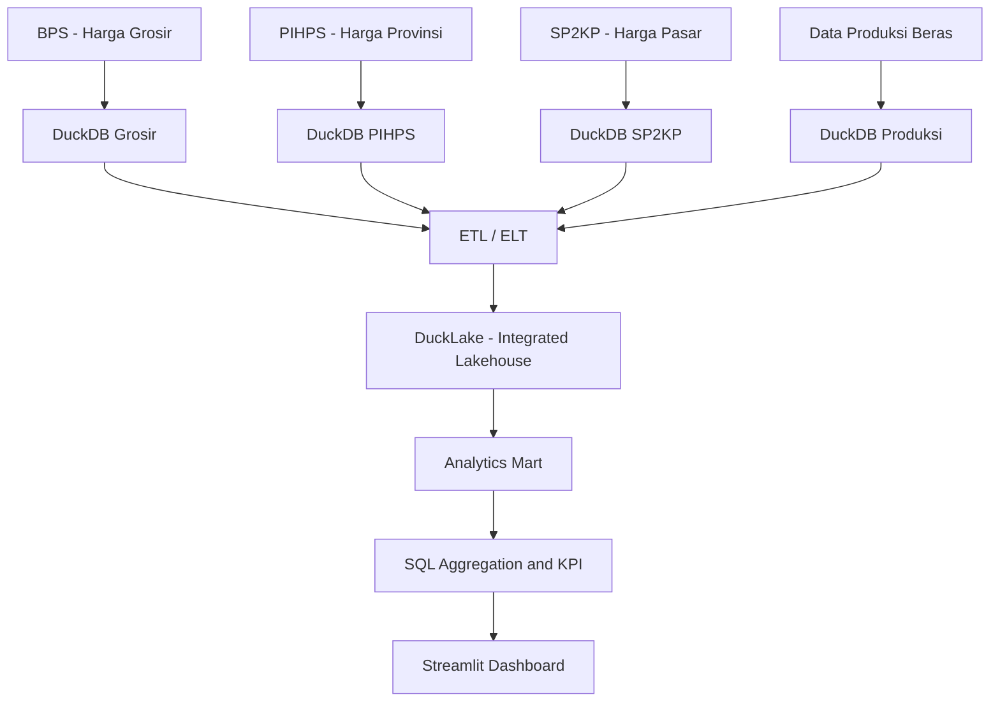

<div align="center">

# 🦆 BebekBerazz

### Indonesian Rice Price & Production Data Warehouse

*Integrating rice price and production data for interactive analytics in Indonesia.*


**Final Project — Data Warehousing**

**Periode analisis: Februari 2024 – Agustus 2026**

[](https://bebekberaz-calonpahlawan100.streamlit.app/)

</div>

---

## 📖 Overview

**BebekBerazz** merupakan project akhir mata kuliah Data Warehousing yang mengintegrasikan data harga dan produksi beras di Indonesia untuk membangun sistem penyimpanan, pengolahan, integrasi, analisis, dan visualisasi data berbasis **DuckDB, DuckLake, dan Streamlit**.

Project ini menggabungkan data harga beras tingkat grosir nasional, provinsi, dan pasar, serta data produksi beras sebagai konteks tambahan untuk memahami dinamika harga. Data dari berbagai sumber diolah melalui proses ETL/ELT dan dirancang untuk mendukung eksplorasi interaktif dari tingkat nasional hingga pasar.

Periode analisis diperluas dari Januari–Agustus 2026 menjadi **Februari 2024–Agustus 2026** (31 bulan kalender). Ketersediaan observasi aktual dapat berbeda antar dataset, wilayah, dan kategori beras.

---

## 🎯 Project Objectives

- Membangun data warehouse yang mengintegrasikan harga dan produksi beras dari berbagai sumber.
- Melakukan standardisasi data dengan granularitas, format, dan kategori yang berbeda.
- Menganalisis tren, perubahan bulanan, serta volatilitas harga beras.
- Membandingkan harga antarprovinsi, antarpasar, dan antarlevel perdagangan.
- Mengeksplorasi keterkaitan produksi beras dengan dinamika harga pada wilayah dan periode yang sebanding.
- Menyediakan dashboard interaktif untuk mendukung eksplorasi dan penyajian informasi.

---

## 📦 Datasets — 4 Bebek

| Dataset | Sumber | Granularitas | Satuan |
| :--- | :--- | :--- | :--- |
| 🦆 Bebek Grosir | Badan Pusat Statistik (BPS) | Nasional × bulan | Rp/kg |
| 🦆 Bebek Provinsi | PIHPS Bank Indonesia | Provinsi × jenis beras × bulan | Rp/kg |
| 🦆 Bebek Pasar | SP2KP Kementerian Perdagangan | Provinsi × kabupaten/kota × pasar × jenis beras × bulan | Rp/kg |
| 🦆 Bebek Produksi | Sumber statistik produksi (metadata menyusul) | Mengikuti wilayah dan periode data sumber | Ton |

### 1. 🦆 Bebek Grosir — Harga Beras Grosir Nasional

Dataset rata-rata harga beras di tingkat perdagangan besar (grosir) Indonesia, yang digunakan sebagai benchmark nasional dalam analisis harga lintas sumber.

**Sumber:** [BPS — Rata-rata Harga Beras di Tingkat Perdagangan Besar (Grosir) Indonesia](https://www.bps.go.id/id/statistics-table/2/Mjk1IzI=/rata-rata-harga-beras-di-tingkat-perdagangan-besar--grosir--indonesia.html)

### 2. 🦆 Bebek Provinsi — Harga Beras PIHPS

Dataset harga beras berdasarkan provinsi, jenis/kualitas beras, dan periode. Kategori pada dokumentasi awal meliputi:

| Kualitas bawah | Kualitas medium | Kualitas super |
| :--- | :--- | :--- |
| Beras Kualitas Bawah 1 | Beras Kualitas Medium 1 | Beras Kualitas Super 1 |
| Beras Kualitas Bawah 2 | Beras Kualitas Medium 2 | Beras Kualitas Super 2 |

**Sumber:** [PIHPS — Bank Indonesia](https://www.bi.go.id/hargapangan/TabelHarga/ProdusenDaerah)

### 3. 🦆 Bebek Pasar — Harga Beras SP2KP

Dataset harga beras pada tingkat pasar untuk mendukung eksplorasi lokasi secara bertingkat dan perbandingan harga antarpasar.

```text
Provinsi
└── Kabupaten/Kota
    └── Pasar
        └── Jenis Beras
            └── Periode dan Harga
```

**Sumber:** [SP2KP — Kementerian Perdagangan](https://sp2kp.kemendag.go.id/statistik/area)

### 4. 🦆 Bebek Produksi — Produksi Beras

Dataset tambahan yang digunakan untuk memberikan konteks sisi produksi dalam analisis harga beras. Pengembangan analitik diarahkan pada:

- Tren volume produksi berdasarkan periode yang tersedia.
- Perbandingan produksi antarwilayah apabila data wilayah tersedia.
- Perbandingan tren produksi dan harga pada periode serta wilayah yang dapat disejajarkan.
- Eksplorasi hubungan statistik antara produksi dan harga, tanpa mengasumsikan hubungan sebab-akibat.

**Sumber:** [BDSP — Kementerian Pertanian Republik Indonesia]([https://sp2kp.kemendag.go.id/statistik/area](https://bdsp2.pertanian.go.id/bdsp/id/bulanan))


---

## 🏗️ Data Warehouse Architecture

Diagram berikut menggambarkan rancangan arsitektur integrasi yang diperbarui untuk mengakomodasi empat kelompok dataset.



| Layer | Fungsi |
| :--- | :--- |
| Data Sources | Data asli dari setiap kelompok sumber |
| Local DuckDB | Raw/staging layer untuk setiap kelompok dataset |
| ETL/ELT | Pembersihan, standardisasi, validasi, dan integrasi |
| DuckLake | Penyimpanan data terintegrasi dan pengelolaan metadata |
| Analytics Mart | Penyediaan data untuk agregasi, KPI, dan analisis |
| Streamlit Dashboard | Penyajian informasi dan visualisasi interaktif |

Rancangan DuckLake menggunakan `shared_catalog.ducklake` sebagai katalog/metadata dan `lakehouse_storage/` sebagai lokasi penyimpanan data fisik, mengikuti dokumentasi awal.

---

## 🔄 ETL / ELT Pipeline

| Tahapan | Proses |
| :--- | :--- |
| **Extract** | Mengambil data dari sumber dan mempertahankan salinan raw |
| **Transform** | Mengubah format wide menjadi long/tidy bila diperlukan, standardisasi waktu, lokasi, kategori beras, tipe data, dan satuan |
| **Validate** | Mengecek missing value, duplikasi, nilai tidak valid, dan kesesuaian granularitas |
| **Load** | Memuat data hasil transformasi ke schema DuckLake masing-masing |
| **Aggregate** | Membentuk tabel atau view analitik menggunakan SQL |
| **Visualize** | Menyajikan hasil analisis melalui Streamlit |

Contoh transformasi konseptual data harga:

**Before (Wide Format)**

| Provinsi | Jenis Beras | Jan 2026 | Feb 2026 | Mar 2026 |
| :--- | :--- | ---: | ---: | ---: |
| Aceh | Medium 1 | 15100 | 14650 | 14450 |

**After (Long Format)**

| Provinsi | Jenis Beras | Bulan | Harga (Rp/kg) |
| :--- | :--- | :--- | ---: |
| Aceh | Medium 1 | 2026-01 | 15100 |
| Aceh | Medium 1 | 2026-02 | 14650 |
| Aceh | Medium 1 | 2026-03 | 14450 |

*Contoh diambil dari dokumentasi awal project untuk menjelaskan bentuk transformasi.*

---

## 🗄️ Lakehouse Schema & Analytics Mart

Berikut rancangan pengembangan schema berdasarkan struktur awal, dengan tambahan kelompok produksi dan analitik antarpasar:

```text
DuckLake
├── grosir
│   └── harga_nasional_bulanan
├── pihps
│   └── harga_provinsi_bulanan
├── sp2kp
│   └── harga_pasar_bulanan
├── produksi
│   └── produksi_beras
└── analytics
    ├── harga_bulanan
    ├── province_summary
    ├── market_summary
    ├── price_gap
    ├── volatility_summary
    ├── market_comparison
    └── production_summary
```

Nama schema dan tabel merupakan rancangan dokumentasi; sesuaikan dengan implementasi SQL aktual pada repository.

---

## 📊 Analytical Features

| Analisis | Deskripsi | Output yang dituju |
| :--- | :--- | :--- |
| Monthly Price Trend | Tren harga beras dari bulan ke bulan | Line chart |
| Month-on-Month (MoM) | Perubahan harga terhadap bulan sebelumnya | Perubahan Rp/kg dan persentase |
| Descriptive Statistics | Mean, median, minimum, maksimum | KPI dan tabel ringkasan |
| Province Comparison | Perbandingan harga antarprovinsi | Ranking dan grafik |
| Rice Quality Comparison | Perbandingan harga antarjenis beras | Grafik per kategori |
| Price Volatility | Fluktuasi harga antarperiode | Standar deviasi dan range |
| Market Explorer | Drill-down provinsi, kabupaten/kota, dan pasar | Grafik serta filter bertingkat |
| Cross-Level Price Comparison | Perbandingan grosir, provinsi, dan pasar | Price gap dan multi-line chart |
| Market Comparison | Perbandingan dua atau lebih pasar | Grafik, ranking, dan selisih harga |
| Rice Production Analysis | Eksplorasi produksi dan keterkaitannya dengan harga | Tren produksi dan perbandingan harga |

### Key Performance Indicators (KPI)

| KPI | Perhitungan / definisi |
| :--- | :--- |
| Average Price | Rata-rata harga pada kelompok terpilih |
| Median Price | Nilai tengah harga |
| Price Change | Harga bulan ini − harga bulan sebelumnya |
| MoM (%) | (Harga bulan ini − harga bulan sebelumnya) / harga bulan sebelumnya × 100% |
| Price Range | Harga maksimum − harga minimum |
| Volatility | Standar deviasi harga selama periode terpilih |
| Price Gap | Selisih harga antara dua kelompok yang dibandingkan |
| Rice Production | Volume produksi ton pada periode yang dipilih |

MoM hanya dihitung jika data bulan sebelumnya tersedia dan nilai penyebut bukan nol.

### Market Comparison — Dalam Pengembangan

Fitur perbandingan antarpasar dirancang untuk melengkapi Market Explorer yang berfokus pada satu lokasi. Pengguna nantinya dapat memilih beberapa pasar untuk membandingkan harga pada jenis beras dan periode yang sebanding, melihat selisih harga, serta mengevaluasi pasar dengan harga relatif tinggi, rendah, stabil, atau fluktuatif.

### Price & Production Analysis — Pengembangan Analitik

Data produksi ditambahkan sebagai kelompok dataset baru. Integrasinya dengan analisis harga mengikuti cakupan wilayah dan periode yang tersedia. Volume produksi bukan ukuran langsung pasokan yang tersedia di pasar; distribusi, persediaan, permintaan, dan faktor lainnya juga dapat memengaruhi harga.

---

## 🖥️ Streamlit Dashboard

**Deployment:** [bebekberaz-calonpahlawan100.streamlit.app](https://bebekberaz-calonpahlawan100.streamlit.app/)

Dashboard menjadi antarmuka utama untuk mengeksplorasi data dan hasil agregasi dari data warehouse. Berikut cakupan halaman/modul berdasarkan dokumentasi awal dan pengembangan terbaru (nama halaman aktual dapat berbeda).

| Halaman / Modul | Fokus |
| :--- | :--- |
| National Overview | Harga grosir nasional dan ringkasan harga provinsi |
| Province Analysis | Tren, statistik, perubahan harga, dan perbandingan provinsi |
| Market Explorer | Eksplorasi harga dengan filter lokasi bertingkat |
| Price Comparison | Perbandingan harga grosir, provinsi, dan pasar |
| Market Comparison | Perbandingan dua atau lebih pasar |
| Rice Production Analysis | Eksplorasi data produksi |

---

## 📁 Repository Structure

Rancangan struktur repository yang diperbarui (bukan daftar file aktual):

```text
bebekberazz/
├── data/
│   ├── raw/
│   │   ├── grosir/
│   │   ├── pihps/
│   │   ├── sp2kp/
│   │   └── produksi/
│   └── processed/
├── databases/
│   ├── bebek_grosir.duckdb
│   ├── bebek_pihps.duckdb
│   ├── bebek_sp2kp.duckdb
│   ├── bebek_produksi.duckdb
│   └── shared_catalog.ducklake
├── lakehouse_storage/
├── src/
│   ├── ingest.py
│   ├── transform.py
│   └── analytics.py
├── app/
│   └── dashboard.py
├── requirements.txt
└── README.md
```

---

## ⚙️ Getting Started

### 1. Install dependencies

```bash
pip install -r requirements.txt
```

### 2. Build the data warehouse

Mengikuti rancangan alur eksekusi pada dokumentasi awal:

```bash
python src/ingest.py
python src/transform.py
python src/analytics.py
```

### 3. Run the dashboard

```bash
streamlit run app/dashboard.py
```

> Perintah di atas mengikuti rancangan struktur repository; nama script, konfigurasi DuckLake, dan persiapan dataset perlu disesuaikan dengan file aktual sebelum dijalankan.

Alternatifnya, akses [Live Dashboard](https://bebekberaz-calonpahlawan100.streamlit.app/).

---

## 🛠️ Technology Stack

| Technology | Purpose |
| :--- | :--- |
| Python | Data processing dan automation |
| DuckDB | Local analytical database dan SQL processing |
| DuckLake | Integrated lakehouse dan metadata management |
| Pandas | Data cleaning dan transformation |
| SQL | Data integration, aggregation, dan analytical queries |
| Streamlit | Interactive dashboard |
| Plotly | Interactive data visualization |
| Git / GitHub | Version control dan project documentation |

---


## ⚠️ Data Quality & Limitations

- Cakupan periode, wilayah, dan kategori dapat berbeda antar dataset.
- Missing value tidak otomatis diubah menjadi nol.
- Nama wilayah, pasar, dan kategori beras perlu distandardisasi sebelum integrasi.
- Perbandingan harga dilakukan pada periode, kategori, dan satuan yang dapat disejajarkan; rata-rata tanpa bobot tidak otomatis mewakili harga nasional resmi.
- Harga grosir, provinsi, dan pasar tidak otomatis sebanding karena metodologi pengumpulan dan tingkat perdagangan dapat berbeda.
- Selisih harga lintas sumber merupakan **price gap**, bukan otomatis margin keuntungan.
- Data produksi perlu dibedakan dari produksi gabah, stok, konsumsi, dan pasokan pasar.
- Hubungan statistik antara harga dan produksi tidak membuktikan kausalitas.

---

<div align="center">

### 🦆 BebekBerazz — From Raw Data to Rice Market Insights

*Final Project · Data Warehousing · Indonesia*

[Explore the Dashboard](https://bebekberaz-calonpahlawan100.streamlit.app/)

</div>
